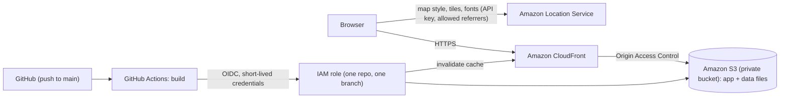

# LankaResilience

**Understand the Risks. Explore the Impact. Discover the Connections.**

An interactive map of Sri Lanka's 25 districts that shows how often historical flood events were reported in each district, 1974–2020. It is an entry for the AWS Builder Center "put data on a map" weekend challenge.

**Live demo: <https://d2dp41607pvuh1.cloudfront.net>**

> The app is deployed by GitHub Actions to a private S3 bucket behind CloudFront. The data files are deliberately **not** in this repository (see [Data and licences](#data-and-licences)); they are generated or downloaded locally and uploaded separately.

<!-- SCREENSHOTS: uncomment once the image files exist in docs/screenshots/
## Screenshots

| Overview | Year filter |
|---|---|
|  |  |

| District detail | Mobile |
|---|---|
|  |  |
-->

## Why this matters

Decades of reported flood events exist as spreadsheets. This app puts them on a map by district and by year, so people can see where flooding has been reported most often and how that changes over time, with the sources and limits visible next to the numbers.

## What it does

- District map of Sri Lanka, coloured by the number of historical flood event entries (a choropleth).
- Year range filter (From / To, 1974–2020). Map colours, legend and numbers update together.
- Sri Lanka overview for the selected years: entries, underlying reports, reported deaths, districts with entries, and the top five districts.
- Click a district, or pick it from a list, to see its totals and an entries-per-year bar strip.
- An "About this data" panel with sources, licence status and limitations.

### What the numbers mean

| Term | Meaning |
|---|---|
| **Entry** | One distinct district-and-date record in the source data. This is the main measure used for colours and rankings. |
| **Underlying reports** | The individual reports that were merged into entries. |
| **Reported deaths** | Deaths as recorded in the source. Not verified. |

The source field for "directly affected" people is empty for Sri Lanka, so it is not shown.

## Built with

- React 19 + Vite, plain JavaScript and CSS
- MapLibre GL JS for the map
- GeoJSON for boundaries; district statistics are joined in the browser, using feature-state to colour each district
- No backend: the app is a static site

## AWS architecture



| Service | Role in this app | Why |
|---|---|---|
| **Amazon Location Service** | Serves the base map (style, vector tiles, fonts, sprites) that the district layer is drawn on. | Managed maps with no tile server to run. An API key restricted to this site's address and to map actions only is the simplest safe authentication for a public static page. |
| **Amazon S3** | Holds the built app and the two data files in a private bucket. | Cheap, durable static hosting. Public access is blocked; only CloudFront can read it. |
| **Amazon CloudFront** | Delivers the site over HTTPS, using Origin Access Control to read the private bucket. | HTTPS and caching, without making the bucket public. |
| **IAM (OIDC)** | Lets GitHub Actions deploy with short-lived credentials. | No AWS access keys are stored in GitHub. The role trusts one repository and one branch and may only write to this bucket and invalidate this distribution. |

The map API key is part of the public JavaScript, as with any browser map. Its protection is the referrer restriction and the map-only permissions, not secrecy.

### Deploying

Every push to `main` runs [.github/workflows/deploy.yml](.github/workflows/deploy.yml): install, build, sync `dist/` to S3, upload `index.html` with no-cache, then invalidate CloudFront. The `data/` prefix is excluded from the sync, so the data files uploaded by hand are never deleted. Settings are kept in GitHub repository variables (role ARN, bucket, distribution ID, regions, map style) and one secret (the map API key). No credentials are in the repository.

To publish new data, upload the files to `data/` in the bucket and invalidate `/data/*`.

### Cost and clean-up

The site is a small static app, so S3 and CloudFront usage is minimal. Amazon Location Service is pay-per-use after any free allowance, so keep a budget alert. After the challenge, delete the CloudFront distribution, the bucket, the IAM role and identity provider, and the Location API key if you do not want them running.

## Data and licences

| Data | Source | Status |
|---|---|---|
| Flood events | Disaster Management Centre (DMC), Sri Lanka, via DesInventar, in the DesInventar sheet of the [USGS Global Flood Impacts Database (GFID)](https://doi.org/10.5066/P135ARGI) | Published by UNDRR on HDX under **CC BY**: [Disaster loss and damage dataset for Sri Lanka](https://data.humdata.org/dataset/disaster-loss-and-damage-dataset-for-sri-lanka). That file is a **2016 export**, while the GFID copy runs to 2020, so applying CC BY to the later records is an inference, not a written confirmation. The app shows only our own per-district, per-year totals. The statistics file is generated locally and is not stored in this repository. No endorsement by DMC, UNDRR or USGS is implied. |
| District boundaries | [geoBoundaries](https://www.geoboundaries.org) Sri Lanka ADM2 (boundary source: OpenStreetMap, Wambacher; year represented 2017) | Open Database License (ODbL) 1.0 per file metadata. The app uses geoBoundaries' own simplified file unmodified and shows the required notice in its About panel. Get the file from the [geoBoundaries release](https://github.com/wmgeolab/geoBoundaries/raw/9469f09/releaseData/gbOpen/LKA/ADM2/geoBoundaries-LKA-ADM2_simplified.geojson). Flood statistics are kept in a separate file, so no derived database is created. |
| Base map | Amazon Location Service | Provider attribution is shown on the map. |

geoBoundaries: Runfola et al. (2020), PLoS ONE 15(4): e0231866. Contains information from geoBoundaries, which is made available under the [Open Database License](https://opendatacommons.org/licenses/odbl/1-0/).

Full details and open questions: [docs/DATA_SOURCES.md](docs/DATA_SOURCES.md).

## Limitations

- Counts reflect what was **reported**, not flood size, depth or extent. This is **not** a flood-risk map.
- Reporting practice varies by place and over time, so districts and years are not strictly comparable.
- Data is at district level; locations inside a district are not shown.
- Colour classes are recalculated for the selected years, so colours are not comparable between different year ranges.
- One entry has no district in the source and is excluded from all totals. Two entries give only a year.
- This is **not** a real-time warning, emergency dispatch or hospital accessibility system.

## Repository layout

```
web/            React + Vite app (src/, public/, index.html)
scripts/        Data preparation (prepare_flood_stats.py)
.github/        Deploy workflow (GitHub Actions)
docs/           Data sources and licence register, screenshots
data/           Local raw and processed data (git-ignored)
CLAUDE.md       Project guide used while building with Claude Code
```

## Running it locally

You need Node.js, Python 3 (standard library only) and an Amazon Location API key.

1. **Install and configure the app**
   ```
   cd web
   npm install
   cp .env.example .env
   ```
   Edit `web/.env` and set `VITE_AWS_LOCATION_API_KEY` (and the region if different). Never commit `.env`.
   The key should allow only the map actions and, ideally, only `http://localhost:5173/*` as a referrer.

2. **Provide the data files.** Because of the licence questions above, these are not in the repo:
   - `web/public/data/districts.geojson`: the geoBoundaries Sri Lanka ADM2 simplified file.
   - `web/public/data/flood_stats.json`: generated from `AggregatedFloodData.xlsx` (download it from the official USGS GFID page) by running, from the project root:
     ```
     python -I scripts/prepare_flood_stats.py
     ```
     The script reads the workbook, never modifies it, and prints a summary of what it kept and what it held out.

3. **Start the app**
   ```
   npm run dev
   ```
   Then open http://localhost:5173. Use `npm run build` for a production build.

## Licence

No licence has been chosen yet. Until one is added, all rights are reserved by the author. Data sources keep their own licences, listed above.
